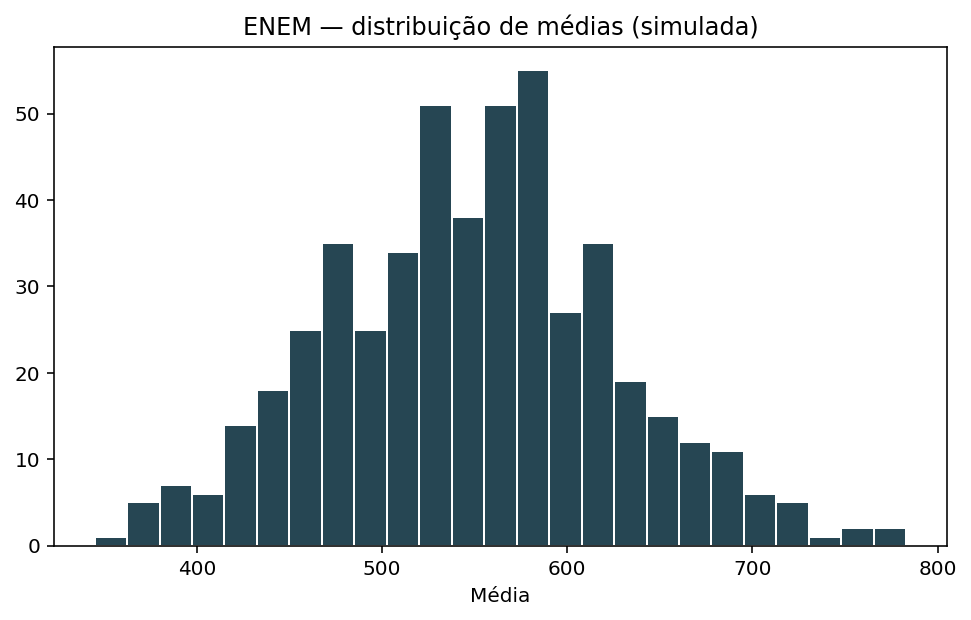

**Data de criação do código:** 5 de abril de 2024

# Análise ENEM



Exploração de microdados do ENEM (notas por escola/UF). Dados locais em `microdados_enem_*` (não versionados).

## Como executar

Arquivo(s) principal(is): `Analise.Rmd`.

```r
# Abra o projeto no RStudio ou, para Shiny:
# setwd(".../Analise ENEM")
# source("main.R")  # quando aplicável
```

## Stack

R, tidyverse, readr

## Estrutura

- Código e notebooks na raiz ou subpastas do diretório do projeto.
- Imagem de capa: `docs/preview.png` (gerada ou copiada de saídas do próprio trabalho).
- Credenciais/dados privados: pasta `secrets/` (ver `SECRETS.md` na raiz do workspace, se existir).

## Dados

Os microdados do INEP não estão neste repositório (arquivos de centenas de MB a alguns GB). Baixe-os em [Microdados do ENEM](https://www.gov.br/inep/pt-br/acesso-a-informacao/dados-abertos/microdados/enem) e coloque-os em `microdados_enem_*` como o notebook espera.

## Licença

Uso acadêmico/pessoal. Ajuste a licença antes de publicar no GitHub.

